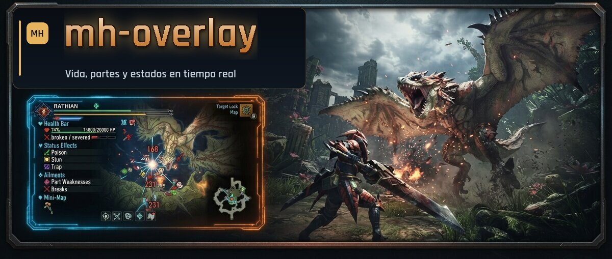

<p align="center">
  
</p>

<p align="center">
  
</p>

<p align="center">
  <strong>Vida de monstruos, daño por parte y estados alterados en Monster Hunter: World y Rise.</strong><br>
  Overlay nativo para Linux, sin inyección ni escritura en la memoria del juego.
</p>

<p align="center">
  <a href="https://github.com/SyberFoxx/mh-overlay/releases/latest"></a>
  <a href="https://github.com/SyberFoxx/mh-overlay/actions/workflows/ci.yml"></a>
  
  
  <a href="LICENSE"></a>
</p>

Lee la memoria del juego mientras corre bajo Proton y dibuja el estado de la cacería encima, sin
inyectar DLLs ni escribir un solo byte en el proceso. Es la alternativa a
[HunterPie](https://github.com/HunterPie/HunterPie) en Linux.

- **Panel sobre el juego** — vida, umbral de captura, reloj y vidas del equipo; partes con
  flinch/romper/cortar; estados alterados; filo, medidores de clase, munición y buffs con
  temporizador. Las 14 armas tienen icono propio.
- **Hub de escritorio** — diagnóstico de la conexión, selección de mapa, vista previa en vivo y
  todos los ajustes con selector de color, sin editar el TOML a mano.
- **Novedades y disposición** — el hub enseña qué cambió en la última release, deja arrastrar
  las placas con imán sobre una pantalla esquemática y guardar presets de disposición.
- **Un solo archivo** — el AppImage se integra en el menú la primera vez y se actualiza solo,
  desde el hub o con `--update`, sin desinstalar ni perder la configuración.
- **Solo lectura** — el crate de memoria no expone un writer a propósito.

**Ir a:** [instalación rápida](#instalación-rápida) · [estado](#estado) · [requisitos](#requisitos) ·
[uso](#compilar-y-usar) · [actualizar](#actualizar) · [configuración](#configuración) ·
[arquitectura](#arquitectura) · [límites](#límites-conocidos) · [roadmap](ROADMAP.md)

```text
cacería  12:34 restante   vidas 0/3

tú  HP  71.2%  (712/1.000)   aguante  84.0%  (126/150)

id 12  Tigrex  HP  74.3%  (16.420/22.100)   captura ≤ 20%
  Cabeza       vida 1.376/2.200  flinch 100.0%  romper  62.4%  cortar 100.0%
  Cola         vida 1.984/2.252  flinch  88.1%  romper  41.9%  cortar  41.9%
  Veneno  45.2%  (120 / 265)
```

## Instalación rápida

Descarga el AppImage desde la [última release](https://github.com/SyberFoxx/mh-overlay/releases/latest),
dale permiso de ejecución y ábrelo:

```bash
chmod +x mh-overlay-*-linux-x86_64.AppImage
./mh-overlay-*-linux-x86_64.AppImage
```

Si tienes más de un AppImage en la carpeta, el comodín del segundo comando no sirve: escribe
el nombre exacto del que acabas de descargar.

No hay que instalar la aplicación: se integra en el menú y, desde ese momento, comprueba si hay
versiones nuevas al abrir el hub. Para abrir la imagen solo hace falta FUSE 2 (o
`--appimage-extract-and-run` si no está). Para leer la memoria del juego hace falta además el
permiso de `ptrace`; el hub lo explica y ofrece concederlo con polkit.

¿Prefieres un paquete con `setcap`? Salta a [instalar el paquete](#instalar-el-paquete-alternativa-con-setcap)
o [compila desde el código](#compilar-y-usar).

## Estado

| | Rise | World |
| --- | --- | --- |
| Capa de memoria (`process_vm_readv`, cadenas, `.map`) | ✅ probado | ✅ probado |
| Adjuntar al proceso y resolver la base del módulo | ✅ probado | ✅ probado |
| Vida actual / máxima y porcentaje | ✅ escrito | ✅ escrito |
| Jugador: vida y aguante | ✅ escrito | ✅ escrito |
| Jugador: arma y filo | ✅ escrito | ✅ escrito |
| Medidores de clase (espíritu, frascos, hacha, demonio, kinsecto) | ✅ escrito | ✅ escrito |
| Espíritu como espada, con color por nivel | ✅ escrito | ✅ escrito |
| Ataque, afinidad y elemento calculados | ✅ escrito | — |
| Munición de ballestas y reserva | — | ✅ escrito |
| Proyectiles de la lanza pistola | — | ✅ escrito |
| Cola de notas y melodías de la cornamusa | — | ✅ escrito |
| Carga del arco | — | ✅ escrito |
| Pestaña **Arma** en el hub | ✅ escrito | ✅ escrito |
| Buffs y estados del jugador | ✅ escrito | ✅ escrito |
| Cacería: reloj y vidas del equipo | ✅ escrito | ✅ escrito |
| Umbral de captura | ✅ escrito | ✅ escrito |
| Partes: flinch / romper / cortar | ✅ escrito | ✅ romper y cortar |
| Vida de las partes en números (opcional) | ✅ escrito | ✅ escrito |
| Vida del monstruo en números (opcional) | ✅ escrito | ✅ escrito |
| Umbral del siguiente rompimiento (`2/3`, `roto`) | — | ✅ escrito |
| Cola cortable y rompible en una sola fila | — | ✅ escrito |
| Nombres de parte | ✅ escrito | ✅ escrito |
| Estados alterados | ✅ escrito | ✅ escrito |
| Nombres de monstruo | ✅ escrito | ✅ escrito |
| Corona de tamaño (miniatura, plateada, dorada) | ✅ escrito | ✅ escrito |
| Mostrar solo el monstruo fijado en el mapa | ✅ escrito (16.0.1.1+) | ✅ escrito (421652+) |
| Overlay gráfico (X11 y Wayland) | ✅ escrito | ✅ escrito |
| Iconos de las 14 armas y fichas de datos de clase | ✅ escrito | ✅ escrito |
| Buffs como iconos con temporizador | ✅ escrito | ✅ escrito |
| Hub gráfico con vista previa en vivo | ✅ probado | ✅ probado |
| Bandeja de sistema (ocultar y salir) | ✅ escrito | ✅ escrito |
| Configuración en caliente | ✅ probado | ✅ probado |
| Editor de ajustes | ✅ probado | ✅ probado |
| Barras sueltas con posición propia y placas | ✅ escrito | ✅ escrito |
| Editor visual de barras con imán | ✅ escrito | ✅ escrito |
| Editor a la resolución real del monitor, con ajuste manual | ✅ escrito | ✅ escrito |
| Guía de primera ejecución: juego, permiso y panel | ✅ escrito | ✅ escrito |
| Presets de disposición guardados en el TOML | ✅ escrito | ✅ escrito |
| Pestaña **Novedades** con notas de la release | ✅ escrito | ✅ escrito |
| Hub rediseñado con barra lateral y tarjetas | ✅ probado | ✅ probado |
| AppImage con actualización en sitio | ⚠️ parcial | ⚠️ parcial |
| Permiso de memoria desde el hub (polkit) | ✅ escrito | ✅ escrito |

Leyenda: ✅ escrito o probado · ⚠️ parcial · ⏳ pendiente

La autoactualización se probó contra un servidor local; falta comprobarla entre dos releases
publicadas. El estado vivo y lo que queda está en [ROADMAP.md](ROADMAP.md).

> **Sin validar en juego.** El entorno donde se escribió esto no tiene ninguno de los dos
títulos instalados. La capa de memoria, el parser de `.map` y la CLI están probados con tests;
los lectores de Rise y World están escritos contra el layout documentado por HunterPie y la
primera ejecución contra un juego real es lo primero que hay que hacer. Los datos de munición,
proyectiles y melodías de World vienen de HunterPie legacy y tampoco se han visto en partida; si
un número sale mal, el sospechoso es el `.map` o el desplazamiento fijo, no la capa de memoria.

## Requisitos

- Linux con glibc (Arch, Debian, Ubuntu, Fedora, openSUSE, Mint, Pop!_OS…). En Alpine/musl hay
  que compilar desde el código.
- Kernel ≥ 3.2 (`process_vm_readv`).
- Rust 1.85+ para compilar.
- Para el **hub**: OpenGL (Mesa o el driver de la tarjeta) y una sesión X11 o Wayland. El panel
  sobre el juego no necesita GL.
- Para el **AppImage**: FUSE 2 (`libfuse2`, en Ubuntu 24.04 `libfuse2t64`). Sin FUSE se puede
  abrir igual con
  `./mh-overlay-*.AppImage --appimage-extract-and-run`.
- Para la **bandeja**: un escritorio con StatusNotifierItem. KDE, XFCE, Cinnamon, Budgie y los
  compositores wlroots lo traen; GNOME necesita la extensión AppIndicator/KStatusNotifierItem.
- El juego corriendo bajo Proton con **modo ventana sin bordes** (el overlay necesita dibujar
  encima; el fullscreen exclusivo lo impide).

### El permiso que todo el mundo olvida

Por defecto Arch y la mayoría de distros traen `kernel.yama.ptrace_scope = 1`, que prohíbe
leer la memoria de un proceso que no sea hijo tuyo. Steam lanza el juego, no `mh-overlay`,
así que sin esto **todas las lecturas fallan** con `EPERM` aunque el proceso se encuentre.

```bash
# opción A: darle la capacidad al binario, permanente y con alcance mínimo
sudo setcap cap_sys_ptrace+ep ./target/release/mh-overlay

# opción B: bajar la restricción mientras juegas, y devolverla después
sudo sysctl kernel.yama.ptrace_scope=0
```

La opción A es preferible. Ojo: si un lanzador corre con `no_new_privs`, la capacidad se
ignora y hay que usar la B.

## Compilar y usar

```bash
cargo build --release
./target/release/mh-overlay                 # hub gráfico
./target/release/mh-overlay --overlay       # panel sobre el juego
```

```
-g, --game <JUEGO>      rise o world; fija el juego y desactiva la detección automática
    --pid <PID>         pid explícito, si hay más de una instancia corriendo
    --map <ARCHIVO>     address map concreto; por defecto, el más nuevo que coincida con el juego
    --base <HEX>        base del módulo, si /proc no la expone
    --overlay           dibujar el panel encima del juego
    --backend <BACKEND> auto (layer-shell de Wayland, cae a X11), wayland o x11
    --settings          abrir el editor de ajustes (no necesita el juego)
    --hub               abrir el hub (es lo que hace sin argumentos)
    --print             imprimir una lectura en la consola y salir
    --position <POS>    top-left, top-right, bottom-left, bottom-right o center
    --config <ARCHIVO>  configuración a usar (por defecto ~/.config/mh-overlay/config.toml)
    --init-config       escribir la configuración documentada y salir
    --watch             refresco continuo en la consola, sin ventana
    --interval <MS>     periodo de refresco; por defecto, el de la configuración
    --list-maps         muestra los address maps disponibles
    --update            actualizar esta instalación (AppImage o paquete) y salir
    --check-update      comprobar si hay versión nueva y salir, sin descargar nada
    --release-notes     imprimir las notas de la última release y salir
```

Sin argumentos se abre el hub. La salida de consola sigue disponible con `--print` (una
lectura) y `--watch` (refresco continuo); el README abre con un ejemplo de esa salida.

```bash
sudo setcap cap_sys_ptrace+ep ./target/release/mh-overlay
./target/release/mh-overlay --print --game world
./target/release/mh-overlay --watch --game rise --interval 250
```

### El panel

```bash
./target/release/mh-overlay --overlay --game rise
```

El panel es una ventana X11 sin decorar (`override-redirect`) y, en sesiones Wayland, una
superficie de la capa `overlay` de `wlr-layer-shell`: en ambos casos va por encima de la ventana
del juego —incluido un juego a pantalla completa—, sin robar el foco y con los clics
atravesándola.

Quién puede poner una ventana encima de un juego a pantalla completa lo decide el compositor.
Con `wlr-layer-shell` funcionan KDE Plasma, Hyprland, Sway, river, niri, Wayfire y el resto de
compositores wlroots o compatibles. GNOME (Mutter) no implementa ese protocolo y no deja
colocar ventanas X11, así que ahí el panel se queda como ventana flotante: se ve sobre el
escritorio, pero un juego a pantalla completa lo tapa. Las salidas son jugar en **«GNOME on
Xorg»** (sesión de la pantalla de acceso, donde el `override-redirect` sí queda encima), dejar
el juego en **ventana sin bordes**, o usar uno de los compositores de la lista. `--backend x11`
fuerza el backend X11 y `--backend wayland` exige layer-shell en vez de caer a X11, para saber
qué está pasando sin adivinar; la CLI imprime el backend que usa al arrancar. Arriba lleva el reloj que
queda de la cacería con las vidas del equipo. Debajo va el jugador: el icono de la clase de arma
(las 14: espadón, espada y escudo, espadas dobles, espada larga, martillo, cornamusa, lanza,
lanza pistola, hacha espada, espada cargada, glaive insecto, ballesta ligera, ballesta pesada y
arco), el nombre, el filo con sus colores y la posición actual, el **medidor de espíritu** de la
espada larga dibujado como una espada que se llena y pasa de blanco a amarillo y rojo según el
nivel, y una fila de **fichas** con los datos de la clase (frascos y carga, hojas del hacha,
modo demonio, esencias y kinsecto). En World las fichas añaden munición cargada y reserva, proyectiles normales y
cargados de la lanza pistola, dragón de fuego y estaca, notas en cola de la cornamusa y carga
del arco. En Rise se añaden ataque, afinidad y elemento calculados por el juego. Cada ficha
lleva su icono, su valor y una línea fina cuando el dato es una carga. La
vida —con la parte recuperable en rojo— y el aguante van debajo. Los buffs y estados ya no son
rayas: son una cuadrícula compacta de iconos con el tiempo restante; los negativos llevan borde
rojo y las familias (ataque, defensa, vida, aguante, elemento, filo, comida, canción…) tienen
dibujo y color propios. Por
monstruo muestra el nombre, la vida en porcentaje, una barra de vida con bisel, marcas cada
10 % y la marca del umbral de captura, y debajo las barras finas de partes (azul, rompible;
ámbar, cortable; dorada cuando ya se rompió) y de estados activos. Junto al nombre va la
corona de talla cuando el ejemplar es excepcional: miniatura (plateada y más pequeña),
plateada o dorada, con la misma forma que usa el juego en las notas del cazador. Con
`overlay.monsters = "target"` el panel enseña solo el monstruo que el juego marca como
objetivo —el fijado en el mapa o el de la cacería— en vez de la zona entera. Las partes rompibles llevan
un hueco por cada rompimiento que aguantan y, a la derecha, el umbral del siguiente
(`2/3`; `roto` cuando ya no queda), para saber cuánto falta sin adivinar por el porcentaje de
vida. Con `overlay.show_part_health` ese umbral y la barra se cambian por la vida real de la
parte (`1.500/2.000`), y con `overlay.show_health_numbers` la vida real del monstruo
(`1.600/2.350`) se suma al porcentaje. Si la tabla trae una cola cortable y otra rompible con
el mismo nombre, el panel las funde en una sola fila.
Las que el juego no rompe ni corta (cuello, brazos, patas) no se muestran, porque solo son
barras llenas que confunden. El redondeo de las esquinas y la región de entrada vacía usan la extensión `SHAPE`;
si el servidor no la tiene, el panel sale rectangular y sigue funcionando.

El tamaño se deriva del contenido y de `overlay.scale`; la posición, de `overlay.position` y
los márgenes. Con `overlay.hide_on_empty` desaparece cuando no hay monstruos grandes en la zona.

Para ver el diseño sin abrir el juego:

```bash
cargo run -p mh-overlay-ui --example preview
```

### AppImage (recomendado)

```bash
chmod +x mh-overlay-0.4.0-linux-x86_64.AppImage
./mh-overlay-0.4.0-linux-x86_64.AppImage
```

Los nombres de archivo de los ejemplos llevan la versión de esta release; si descargas otra,
usa su nombre.

Un solo archivo: lleva dentro el binario, los mapas y el lanzador. Al abrirlo por primera vez se
integra en el menú de aplicaciones del usuario y se queda ahí; no hay que instalar, ni copiar
carpetas, ni ejecutar nada con `sudo`.

El hub comprueba la última release al arrancar y, si hay una versión nueva, lo avisa en la barra
lateral con el botón **Instalar actualización**. Al terminar ofrece **Reiniciar ahora**, que
vuelve a abrir el AppImage ya reemplazado. También se puede actualizar a mano con:

```bash
./mh-overlay-0.4.0-linux-x86_64.AppImage --update
```

Baja la última release, comprueba su SHA-256 y reemplaza **ese mismo archivo** de forma atómica.
No hay que desinstalar: la configuración vive en `~/.config/mh-overlay` y se conserva, y el
lanzador del menú sigue apuntando al AppImage actualizado. Si el archivo está en una carpeta de
solo lectura, el actualizador lo dice y no toca nada.

El AppImage se genera con:

```bash
./scripts/appimage.sh
```

Deja `dist/mh-overlay-<versión>-linux-<arquitectura>.AppImage` y su `.sha256`. Descarga
`appimagetool` 1.9.1 la primera vez en `target/appimage/`, comprueba su SHA-256 y no necesita FUSE
para empaquetar. La imagen lleva los iconos en 128, 256 y 512 px, el lanzador con el ID de la
aplicación y metadatos AppStream; `appimagetool` los valida antes de generar la imagen.

### Instalar el paquete (alternativa con `setcap`)

```bash
./scripts/package.sh
```

Deja en `dist/` un `mh-overlay-<versión>-linux-<arquitectura>.tar.gz` con el binario, los mapas,
la plantilla de configuración, los iconos (SVG y PNG de 128, 256 y 512 px), los metadatos
AppStream, el lanzador de menú y un `install.sh` que funciona en cualquier distribución. En la
otra máquina:

```bash
tar xzf mh-overlay-0.4.0-linux-x86_64.tar.gz
cd mh-overlay-0.4.0-linux-x86_64
./install.sh --check     # qué hay en el sistema antes de tocar nada
./install.sh             # instalación de usuario, sin sudo
```

Sustituye `0.4.0` por la versión del tarball que hayas descargado.

La instalación de usuario deja el programa en `$XDG_DATA_HOME/mh-overlay` (por defecto
`~/.local/share/mh-overlay`), el enlace en `~/.local/bin/mh-overlay`, el lanzador
`io.github.syberfoxx.mh_overlay.desktop` en `~/.local/share/applications`, los iconos en
`~/.local/share/icons/hicolor/{128x128,256x256,512x512,scalable}/apps` y los metadatos en
`~/.local/share/metainfo`. Los directorios se pueden cambiar con `XDG_DATA_HOME`, `XDG_BIN_HOME` y
`XDG_CONFIG_HOME`; la instalación de sistema usa `share/` bajo el prefijo.

Para todos los usuarios, con root o sudo:

```bash
sudo ./install.sh --system
```

Eso instala en `/usr/local/lib/mh-overlay`, enlaza `/usr/local/bin/mh-overlay` y deja el lanzador
y el icono en `/usr/local/share`. Un prefijo propio (útil para probar o para empaquetar):

```bash
./install.sh --prefix /tmp/mh-overlay
DESTDIR=/tmp/pkg ./install.sh --system --prefix /usr   # para un .deb/.rpm
```

Volver a ejecutar `install.sh` sobre una instalación existente la actualiza en sitio y conserva
`~/.config/mh-overlay`. Para desinstalar:

```bash
./install.sh --uninstall          # conserva la configuración
./install.sh --uninstall --purge  # borra también ~/.config/mh-overlay
```

El binario del paquete solo enlaza glibc; el hub carga OpenGL/EGL en tiempo de ejecución y avisa
si falta. Los mapas van dentro del paquete porque son pequeños y así funciona sin el árbol de
código. En Alpine/musl, o en una arquitectura distinta de `x86_64`/`aarch64`, hay que compilar
con `cargo build --release`.

### Publicar una release

El job `package` de CI valida AppStream y los `.desktop`, empaqueta el tarball y el AppImage, y
prueba el binario, la actualización y una instalación real en un prefijo temporal en cada push.
El flujo `.github/workflows/release.yml` repite el empaquetado en Ubuntu, ejecuta
`scripts/package.sh` y `scripts/appimage.sh`, y deja el `.tar.gz`, el `.AppImage` y sus `.sha256`
como artefacto. Al empujar una etiqueta `v*` también los adjunta a la release de GitHub:

```bash
git tag v0.4.0
git push origin v0.4.0
```

Sin etiqueta, `workflow_dispatch` sirve para comprobar el empaquetado desde la pestaña Actions.

### Actualizar

```bash
mh-overlay --update
```

Baja la última release de GitHub, comprueba su SHA-256 y reemplaza la instalación **en sitio**:
si corre desde un AppImage cambia la imagen entera, y si corre desde el paquete cambia el binario
y los mapas. No hay que desinstalar nada y la configuración no se toca. El archivo nuevo se
escribe al lado con otro nombre y se renombra encima, así que una actualización a mitad de
cacería nunca deja un ejecutable truncado, y un paquete cuyo checksum no coincide se rechaza sin
tocar lo instalado. El hub consulta la última release al arrancar (la etiqueta y las notas, sin
bajar el binario), avisa si hay una versión nueva y deja instalarla y reiniciar sin abrir una
terminal; la pestaña **Novedades** enseña el cuerpo de la release. **Buscar actualización**
repite la consulta cuando se pide, `--check-update` la hace desde la consola y
`--release-notes` imprime las notas sin descargar nada. Si el binario tenía `cap_sys_ptrace`, el archivo nuevo la pierde al cambiar
de inodo: el actualizador intenta restaurarla y, si no tiene permisos, imprime la orden exacta.

Para probar el actualizador o usar un espejo, `MH_OVERLAY_UPDATE_API` y
`MH_OVERLAY_UPDATE_DOWNLOADS` cambian las URL de la API y de las descargas.

### Configuración

La primera vez que se ejecuta se escribe una plantilla comentada en
`$XDG_CONFIG_HOME/mh-overlay/config.toml` (o en la ruta de `--config`). El archivo se relee al
guardarlo: cambiar un color o la posición con el juego abierto se aplica en el siguiente
refresco, sin reiniciar.

**El juego se detecta solo.** Con `auto_detect = true` (por defecto), el hub y la CLI miran si
está corriendo `MonsterHunterRise.exe` o `MonsterHunterWorld.exe` y usan ese juego, sin tocar
`kind`. Elegir uno a mano en el hub apaga la detección para que la elección no se pierda en el
siguiente refresco; se vuelve a activar con la casilla «Detectar Rise/World automáticamente».
`--game` también manda sobre la detección.

Los flags de la CLI ganan al archivo, y el archivo gana a los valores por defecto. Un valor sin
sentido (una escala de 12, un juego que no existe, un color mal escrito) es un error con el
campo culpable: al arrancar aborta, y en caliente se descarta el archivo nuevo y se sigue con el
anterior, porque cerrar el overlay en mitad de una cacería es peor que quedarse con el último
estado bueno.

```toml
[game]
kind = "rise"          # solo si no hay juego abierto o auto_detect = false
auto_detect = true
interval_ms = 500

[overlay]
position = "top-left"
margin_x = 24
margin_y = 24
scale = 1.0
monsters = "zone"
max_monsters = 4
show_parts = true
# Vida real de cada parte (actual/máximo) en vez del umbral de rompimiento.
show_part_health = false
show_ailments = true
# Vida real del monstruo (actual/máximo) junto al porcentaje.
show_health_numbers = false
# panel: una tarjeta con todo; free: una placa por barra.
layout = "panel"
click_through = true
hide_on_empty = true
# Posiciones del modo free, en píxeles desde la esquina superior izquierda.
# Las que falten se apilan en una columna desde margin_x/margin_y.
# [[overlay.bars]]
# id = "player.health"
# x = 24
# y = 760
#
# [[overlay.bars]]
# id = "monster.0"
# x = 24
# y = 24
# direction = "down"   # down: partes debajo; right: partes a la derecha
#
# Presets que aparecen en el hub para reaplicar una disposición:
# [[overlay.presets]]
# name = "Monstruo a la derecha"
# [[overlay.presets.bars]]
# id = "monster.0"
# x = 24
# y = 24
# direction = "right"

[hub]
# El hub enseña la guía de primera ejecución; se marca al terminarla o saltarla.
onboarding_done = false

[style]
panel = "#0b0d12e6"
health = "#7fd47f"
low_health = "#e2565c"
low_health_percent = 25.0
capture = "#e6b45e"
part = "#4f8dd6"
severable = "#d69a4f"
```

Los colores admiten `#rgb`, `#rrggbb` y `#rrggbbaa`. En el modo panel el alfa se compone sobre
negro antes de subir la imagen, así que se ve igual con o sin compositor. En el modo free el
fondo es transparente: Wayland compone el alfa y X11 recorta la ventana a las placas con
`SHAPE`, de modo que entre barra y barra se ve el juego.

### Editor de ajustes

```bash
./target/release/mh-overlay --settings
```

Una ventana normal, con ratón y teclado, que edita lo que más se toca a mano: disposición
(panel o barras sueltas), posición, márgenes, escala, monstruos a la vez, refresco y los
interruptores (partes, estados, clics que atraviesan, ocultar sin monstruos). Cada cambio se guarda en el TOML al instante, así
que un overlay que esté corriendo lo aplica en el siguiente refresco sin reiniciar nada. Con el
ratón se pulsa `-`/`+` o el interruptor; con el teclado, `arriba`/`abajo` eligen fila,
`izquierda`/`derecha` cambian el valor y `Esc` cierra.

Los colores no están en el editor: son cinco selectores hexadecimales que se tocan una vez y se
olvidan, y meterlos en la misma ventana sin un selector de color de verdad habría sido peor que
editarlos en el TOML.

Con **Barras sueltas** el hub añade un editor visual sobre la resolución real del monitor:
arrastra una placa y se imanta a la rejilla de 10 px, al centro y a los bordes. Si la detección
no coincide (Wayland con escala o varias pantallas), el ancho y alto del lienzo se ajustan a
mano. El grupo `monster.N` mueve vida, partes y estados juntos; debajo queda la tarjeta numérica
X/Y para ajustar al píxel.

### Barras sueltas

Con `overlay.layout = "free"` el panel desaparece y cada barra pasa a ser una placa con su
propio fondo y su propia posición. Las posiciones se escriben en píxeles desde la esquina
superior izquierda de la pantalla:

```toml
[overlay]
layout = "free"

[[overlay.bars]]
id = "player.health"
x = 24
y = 760

[[overlay.bars]]
id = "monster.0"
x = 24
y = 24
direction = "down"
```

```toml
[[overlay.presets]]
name = "Monstruo a la derecha"

[[overlay.presets.bars]]
id = "monster.0"
x = 24
y = 24
direction = "right"
```

| id | Qué mueve |
| --- | --- |
| `hunt` | Reloj y vidas del equipo |
| `player.health` | Vida del jugador |
| `player.stamina` | Aguante |
| `weapon` | Arma, filo, espíritu y fichas de clase |
| `buffs` | Cuadrícula de buffs |
| `monster.0` … `monster.7` | Vida del monstruo y, pegadas, sus partes y estados |
| `status` | Aviso cuando no hay monstruos |

**`monster.N` es un bloque**: mover la vida del monstruo mueve también sus partes y estados,
siempre. `direction = "down"` las pone debajo, en columna; `direction = "right"`, a la derecha
de la vida. Las barras que no tengan entrada se apilan en una columna desde `margin_x` y
`margin_y`, así que se puede empezar con una sola posición y añadir el resto poco a poco. En
este modo `position` solo elige dónde empieza esa columna por defecto; no recoloca las barras
que ya tienen coordenadas. Con `click_through = false`, solo las placas reciben clics: el resto
de la pantalla sigue siendo del juego.

Desde el hub, **Presets** trae dos disposiciones integradas (compacto y monstruo a la derecha),
deja guardar la actual con un nombre y eliminarla. Los presets propios viven en
`[[overlay.presets]]` y se aplican copiando sus posiciones en `[[overlay.bars]]` con
`layout = "free"`.

### Hub de escritorio

```bash
mh-overlay          # sin argumentos: abre el hub
mh-overlay --hub    # equivalente explícito
```

Una ventana normal pensada para cuando algo no funciona, porque el panel sobre el juego no
tiene sitio para explicarse. La barra lateral cambia entre **Novedades**, **Diagnóstico**,
**Arma** y **Ajustes**, y abajo quedan el estado de la conexión, **Abrir/Cerrar panel**, la
comprobación de actualizaciones (aviso, **Instalar** y **Reiniciar** cuando toca) y la versión
instalada. **Novedades** consulta la última release de GitHub, enseña sus notas y permite
reintentar la consulta o instalar la versión nueva. La pestaña **Diagnóstico** enseña el proceso encontrado,
la base del módulo, qué `.map` se está usando y si sus CRC coinciden con la build, cuántos
monstruos, jugador y cacería se leyeron y el último error, refrescándose sola al ritmo
configurado. Si el error es de permisos, ofrece copiar la orden exacta o **conceder el acceso
con polkit**, sin abrir una terminal. La
pestaña **Arma** enseña la clase equipada, el detalle del filo, el medidor completo y los datos
de combate disponibles: munición y reserva de las ballestas, proyectiles de la lanza pistola,
notas y melodías de la cornamusa, carga del arco y, en Rise, ataque, afinidad y elemento. La
pestaña **Ajustes** edita juego, refresco, disposición, anclaje, márgenes, escala, qué monstruos
se enseñan (toda la zona o solo el objetivo), cuántos a la vez, los interruptores —incluidos los
números de vida de partes y monstruo— y todos los colores con un selector de color real, con el
panel de ejemplo al lado: lo que ves es lo que se dibuja. La primera vez que abres el hub
aparece una **guía de tres pasos** para elegir juego, explicar el permiso de memoria y abrir el
panel; se puede saltar y volver a ver desde **Ajustes → Guía**. Al elegir **Barras sueltas** aparece
una tarjeta para colocar cada barra con sus coordenadas X/Y y, en los monstruos, elegir si las
partes cuelgan hacia abajo o hacia la derecha. Los cambios se guardan solos en el TOML en cuanto sueltas
el control, así que un overlay abierto los aplica en el siguiente refresco.

La vista previa usa la lectura **en vivo** cuando hay partida: enseña el arma, el filo, los
buffs, los monstruos y las partes tal como están en ese momento. Sin juego cae a datos de
ejemplo. El botón **Abrir panel** lanza el overlay como proceso aparte y **Cerrar panel** lo
termina, sin salir del hub. Si cierras la ventana con el panel abierto, el hub se oculta en la
bandeja para no cortarlo y sigue leyendo; sin panel, cerrar termina el proceso, también con
Super+Q. El icono de la bandeja tiene «Mostrar», «Abrir/Cerrar panel» y «Salir». Si el escritorio
no ofrece bandeja, cerrar termina el proceso en vez de esconder la ventana sin retorno.

El hub detecta solo si estás jugando Rise o World y cambia de juego (y de mapa) en el siguiente
refresco; la barra superior lo marca con «auto». Si eliges un juego a mano, la detección se
apaga para no pisar tu elección, y se reactiva con la casilla de Ajustes. En «Mapa» puedes
elegir a mano cualquiera de los `.map` de `data/maps` en vez de dejar que se use el más nuevo:
es la salida cuando la build del juego es más nueva que el último mapa y el CRC no coincide. Con
`--game` y `--map` el hub arranca ya apuntando a ese juego y ese archivo, y esos dos flags **no**
se guardan en el TOML: son de la ejecución, no de la configuración.

El hub necesita OpenGL y una sesión X11 o Wayland; el panel sobre el juego **no**: ese sigue
siendo el lienzo propio, subido por X11 o por `wl_shm` según la sesión, para no depender de GL. En Arch, `mesa` ya trae `swrast`, así que funciona incluso sin aceleración; si la ventana
falla al abrir, el error dice qué falta y el panel sigue disponible con `--overlay`.

## Arquitectura

```
crates/
├── mh-overlay-memory   proceso, /proc, process_vm_readv, cadenas de punteros, parser .map
├── mh-overlay-games    rise.rs, world.rs, modelo compartido
├── mh-overlay-config   TOML documentado, validación, recarga y ruta XDG
├── mh-overlay-ui       lienzo, tipografía y superficie X11/Wayland
├── mh-overlay-app      hub de escritorio: diagnóstico y ajustes con vista previa
└── mh-overlay-cli      binario mh-overlay
data/maps/              66 address maps por versión de juego (ver NOTICE)
```

El dibujo está separado de X a propósito: `mh-overlay-ui::view` produce una imagen a partir
del estado del juego y `window` solo la sube, así que la maquetación se prueba con tests sin
servidor gráfico.

Tres ideas sostienen todo lo demás:

1. **La base del módulo se resuelve en cada attach.** `/proc/<pid>/maps` da la dirección de
   carga de `MonsterHunterRise.exe`; las direcciones estáticas del `.map` son relativas a ella
   y cambian con ASLR.
2. **Hay dos formas de cadena de punteros y no son intercambiables.** `deref_chain` hace
   `addr = *(addr) + offset`; `follow_ptr_chain` hace `addr = *(addr + offset)`. HunterPie las
   llama `ReadAsync` y `ReadPtrAsync`; usar la equivocada devuelve basura plausible.
3. **Los offsets son datos, no código.** Viven en `data/maps/MonsterHunterRise.<versión>.map`.
   Cuando el juego parchea, se añade un archivo, no se recompila. Un `.map` que no parsea es un
   error, nunca un fallback silencioso.

Para añadir un juego: un módulo en `mh-overlay-games` y una variante en `GameKind`. Nada más.

## Los address maps

Los archivos de `data/maps/` vienen de HunterPie (Apache-2.0, ver `NOTICE`) y son el resultado
de su reverse engineering. Este repositorio no reutiliza su código C#, pero sí esas tablas:
son la parte cara del problema y ya están resueltas para 16 builds de World, 19 de Rise y 31 de
Wilds (Wilds aún sin lector).

Un mapa y una build no son intercambiables: usar el archivo más nuevo contra un juego viejo no
falla, devuelve basura plausible. Por eso el binario elige el mapa más nuevo cuyo par
`Address CRC_FUNC_*` + `Instruction CRC_ORIGINAL_*` coincide byte a byte con la memoria del
juego, y avisa por stderr de la versión elegida. Un mapa que no trae CRC no se puede verificar;
`--map` sigue permitiendo forzar uno. Los números de los mapas son hexadecimales aunque les
falte el `0x`, igual que en HunterPie.

Si actualizas un mapa a mano, sube el archivo con el número de versión del ejecutable en el
nombre. `--map` permite probar uno sin tocar los demás.

## Las tablas de datos

`crates/mh-overlay-games/src/tables.rs` es un archivo generado: trae el umbral de captura de
World, el nombre de cada parte y de cada monstruo, y los estados alterados de World. Cada parte
trae además si se puede cortar y cuántos golpes aguantan sus rompimientos, que es lo que dibujan
los huecos de la barra. Los datos
salen de los `MonsterData.xml` de HunterPie (Apache-2.0) y de su localización `es-es` (MIT). El
generador es `scripts/generate_tables.py` y se niega a escribir la tabla si alguna parte
queda sin nombre, para que un hueco se vea como `parte NN` y no como una etiqueta a medias:

```bash
python3 scripts/generate_tables.py ruta/rise/MonsterData.xml ruta/world/MonsterData.xml \
    ruta/localization/es-es.xml crates/mh-overlay-games/src/tables.rs
```

Rise identifica las partes por su posición en el array, así que su tabla conserva el orden y
los huecos; World las identifica por el índice que reporta el juego.

## Límites conocidos

- **Solo lectura.** No hay escritura ni inyección; el crate no expone un writer a propósito.
- **El detalle del arma depende de lo que exponga cada juego.** World tiene munición,
  proyectiles de la lanza pistola, cola de la cornamusa y carga del arco a partir de los offsets
  de HunterPie legacy; Rise no publica esas estructuras en los mapas que lee HunterPie v2, así
  que allí solo se muestran ataque, afinidad y elemento. El nombre del arma y sus estadísticas
  base no están en los mapas: no se inventan.
- **La tabla de nombres de munición de World es posicional.** Si una build cambia el orden de
  las 40 ranuras, los contadores siguen siendo correctos pero el nombre puede no corresponder;
  el índice de la ranura se conserva para detectarlo.
- **La bandeja necesita StatusNotifierItem.** KDE, XFCE, Cinnamon, Budgie y los compositores
  wlroots la traen; GNOME necesita la extensión AppIndicator/KStatusNotifierItem. Sin bandeja,
  cerrar la ventana termina el proceso y lo dice por stderr.
- **El instalador no instala dependencias con apt/dnf/pacman**: comprueba el entorno y deja el
  binario con sus mapas. OpenGL para el hub y `cap_sys_ptrace` para leer memoria se avisan en
  `--check` y en el mensaje final.
- **El AppImage no puede llevar `cap_sys_ptrace`**: la capacidad se aplica al archivo que se
  ejecuta, y dentro de la imagen es de solo lectura. Con AppImage usa
  `kernel.yama.ptrace_scope=0` (el hub ofrece «Conceder acceso» con polkit) o instala el tarball y
  aplica `setcap` al binario. La actualización del AppImage no pierde el permiso porque no depende
  del archivo.
- **Wilds no está soportado** todavía, aunque sus mapas están incluidos.
- **Los nombres están solo en castellano**: la tabla se genera desde la localización `es-es`
  de HunterPie. Otra lengua es volver a generarla con ese archivo.
- **Las partes sin nombre en la tabla del juego se muestran como `parte NN`**: algunos
  monstruos tienen índices que HunterPie tampoco nombra.
- **Los estados de World se muestran sin contador**: la estructura trae cuántas veces se ha
  aplicado el estado, pero el panel todavía no lo enseña.
- **Las partes de World que no se rompen ni se cortan no se muestran**: el juego las deja con la
  vida al máximo y sin contador, y una barra siempre llena solo estorba. Si un monstruo no tiene
  ninguna parte rompible en la tabla, el panel omite la lista de partes.
- **Algunas colas traen dos entradas en la tabla de World**: una cortable y otra rompible. El
  panel las funde en una fila: la barra mide el corte y el contador usa los umbrales de la
  entrada rompible.
- **El contador de rompimientos usa los umbrales de la tabla, no tramos**: muestra golpes
  acumulados frente al siguiente umbral (`2/3`, luego `3/6`) y `roto` cuando no queda ninguno;
  las partes cortables no llevan contador. El número de vida real de la parte está disponible
  con `overlay.show_part_health`.
- **El objetivo del panel depende de lo que exponga el mapa**: Rise solo trae el monstruo
  marcado por la cacería desde el mapa 16.0.1.1 y World solo trae el fijado en el mapa desde la
  build 421652. En los anteriores, `overlay.monsters = "target"` no tiene nada que leer y el
  panel enseña la zona entera; sin objetivo marcado hace lo mismo, para no quedarse vacío a
  mitad de cacería.
- **La corona se calcula con el tamaño de la instancia**: se compara la talla que sorteó el
  juego con los umbrales de `MonsterData.xml` (los mismos que usa HunterPie), no con las notas
  del cazador. Un ejemplar con corona no aparece todavía registrado en el juego hasta que
  completes la cacería, y los monstruos de talla fija nunca llevan corona.
- **Rise distingue algunos estados solo por un flag**: veneno severo frente a veneno y burbujas
  grandes frente a pequeñas comparten offset, y el panel muestra un único nombre por offset en
  vez de arriesgar la fila equivocada. Las habilidades de armadura que solo se anuncian por
  flag (Agitador, Berserk, Deriva...) tampoco aparecen todavía.
- **Las canciones de Rise no guardan su máximo**: el juego solo escribe lo que queda, así que la
  barra aprende la duración en la primera ejecución de cada canción.
- **Jugador y cacería se leen con desplazamientos fijos**, no con claves de los mapas, porque
  sus estructuras no cambian de sitio entre builds: si una actualización los mueve, esas dos
  secciones desaparecen (el resto del panel sigue) hasta corregir las constantes.
- **El reloj de World se guarda en tics de 60 Hz** y se divide para mostrarlo; es la misma
  cuenta que hace HunterPie desde la build 421631.
- **World solo expone la lista de monstruos desde la build 421652**; los mapas anteriores no
  definen `MONSTER_LIST_ADDRESS` y el binario lo dice en vez de inventar direcciones.
- **Wayland necesita `wlr-layer-shell`**: en una sesión Wayland el panel se pone en la capa
  `overlay`, que es lo único que un compositor dibuja sobre un juego a pantalla completa. Los
  compositores wlroots (Hyprland, Sway, river…) lo ofrecen; GNOME no implementa el protocolo y
  ahí no hay capa que usar. Si falta, el panel avisa por stderr y cae a la ventana X11, con la
  que en fullscreen puede quedar debajo del juego. No hay plan B estándar: el resto de
  soluciones pasan por dibujar dentro del juego (inyección), que este proyecto no hace.
- **El panel lo coloca el compositor**: la capa se crea sin output fijo, así que aparece en el
  monitor activo (en Hyprland, el que tiene el foco al arrancar, que es el del juego) y se queda
  ahí aunque cambies de escritorio virtual. Con dos pantallas de distinto tamaño, anclar el
  panel a la derecha o abajo usa el tamaño del primer monitor.
- **El panel es opaco**: la translucidez del TOML se compone sobre negro en vez de dejar ver el
  juego a través, porque debajo de un juego a pantalla completa no hay compositor garantizado.
- **Los colores se editan solo en el TOML**: el editor cubre posición, tamaño y visibilidad.
- **Online**: leer memoria no modifica el juego, pero ningún método de este tipo tiene garantía
  del publisher. Úsalo bajo tu criterio.

## Próximos pasos

La lista viva de lo que falta —validar los lectores en juego, probar la actualización real,
diagnóstico exportable— está en [ROADMAP.md](ROADMAP.md), junto con el criterio para dar el
proyecto por completo.

## Licencia

Apache-2.0. Los datos de `data/maps/` y las tablas generadas son de HunterPie (Apache-2.0 y
MIT según el archivo), y la tipografía Rajdhani es SIL OFL 1.1; los detalles de atribución
están en `NOTICE`.
